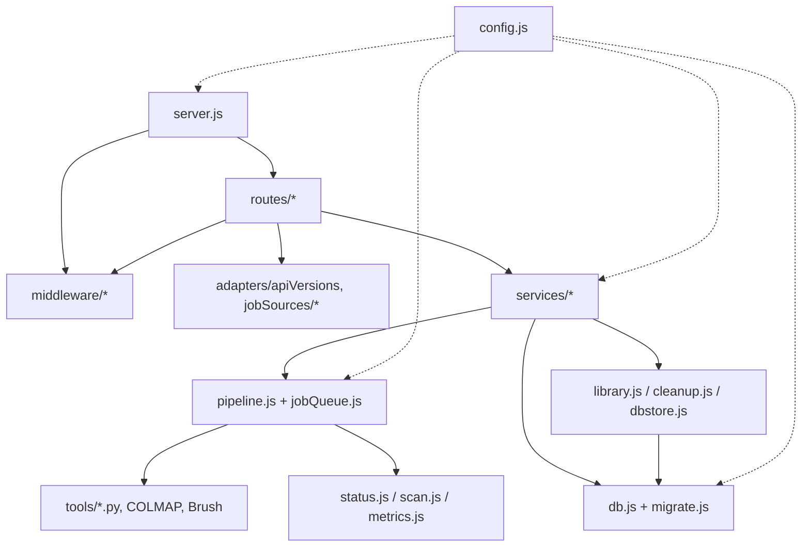

# Backend architecture (`packages/src/backend/`)

A **Node.js / Express 5** server (ES modules) that turns photos or videos of an object into a 3D Gaussian Splat `.ply` using **COLMAP** (camera poses) and **Brush** (splat training). It serves the built React website and a versioned **HTTP JSON API** (`/api/v1/...`, plus deprecated legacy paths) used by the website, the C++ engine and the curl smoke test. Data lives in **SQLite** (`node:sqlite`, `data/app.db`) and in per-job folders under `jobs/`. Older overviews are in [`docs/architecture.md`](../../architecture.md), [`docs/data-schema.md`](../../data-schema.md) and [`docs/api-changelog.md`](../../api-changelog.md). Every endpoint is described with examples in `backend/openapi.yaml` (OpenAPI 3.1).

## Account modes (`AUTH_MODE`)
| Mode | Machine | Accounts | Builds |
|---|---|---|---|
| `local` | a single machine | its own database | built here |
| `client` | a team machine with a GPU | sign-up and login sent to the VM, mirrored locally | built here, then **sent to the VM's shared library** |
| `authority` | the VM | the account database, `/register`, `/verify-account`, `/library/*` for team machines | stores every machine's finished jobs, optionally **in the database** (`FILE_STORE=db`), with storage clean-up |

## Layers

## Life of a build
1. `POST /upload` (photos) or `POST /jobs/from-media` (videos). Upload middleware stores the files in order (`0000.jpg`, …) and checks their real type. The route makes the job, saves `status.json` and answers **202 `{ id }`**.
2. Media jobs extract frames first (`extract_frames.py`).
3. `queueBuild`: one build per user at a time, different users in parallel, with an optional machine-wide cap.
4. `runPipeline`: optional masks, COLMAP features, matching and mapping, Brush training, optional auto-crop, `normalize_ply.py`, metrics, and a copy into the engine's samples folder.
5. The browser polls `GET /jobs/:id` (status, phase, progress, detail, `logTail`).
6. `afterJobEnds`: cover, prune, sync to the VM (client), move into the database (VM with `FILE_STORE=db`), thumbnails, clean-up.
7. `GET /jobs/:id/result.ply` downloads the model (with byte ranges), and the viewer loads it.

## File index
| Area | Page |
|---|---|
| Entry and configuration | [server](server.md), [config](config.md) |
| Pipeline | [pipeline](pipeline.md), [jobQueue](jobQueue.md), [status](status.md), [scan](scan.md), [metrics](metrics.md) |
| Data | [db](db.md), [dbstore](dbstore.md), [migrate + migrations](migrate.md) |
| Shared library and storage | [library](library.md), [cleanup](cleanup.md) |
| Reference data, validation, limits | [catalog / schemas / ratelimit](catalog-schemas-ratelimit.md) |
| Middleware | [session](middleware/session.md), [limits](middleware/limits.md), [uploads](middleware/uploads.md), [sendDbModel](middleware/sendDbModel.md), [timing](middleware/timing.md), [errors](middleware/errors.md) |
| Adapters | [apiVersions](adapters/apiVersions.md), [jobSources](adapters/jobSources.md) |
| Services | [jobs](services/jobs.md), [accounts](services/accounts.md), [authority](services/authority.md), [google](services/google.md), [passwordReset](services/passwordReset.md), [performance](services/performance.md), [feedback / scenes / mail](services/feedback-scenes-mail.md) |
| Routes | [jobs](routes/jobs.md), [auth](routes/auth.md), [account](routes/account.md), [passwordReset](routes/passwordReset.md), [libraryStore](routes/libraryStore.md), [feedback / scenes](routes/feedback-scenes.md), [sampleJobs / catalog / docs / metrics](routes/small-routes.md) |
| Tests | [tests/](tests/README.md) |
| Scripts and tools | [perf-budget / load-test / stress-test](tools/perf-load-stress.md), [tools/*.py and the API smoke test](tools/python-tools.md) |

## Data files (not code)
- `catalog/catalog.json`: feedback categories, training presets (Fast 5000, Normal 7000, Detailed 10000), `minPhotos` and feedback length limits.
- `schemas/*.schema.json`: `catalog`, `job-summary`, `job-status`, `sample-jobs` and `scene.v1`, all JSON Schema draft-07.
- `sample-data/jobs.json`: the read-only sample jobs.
- `.env.example`: every environment variable, with explanations. The real `.env` is gitignored, and `secrets.test.js` checks that.
- `openapi.yaml`: the full API reference.
