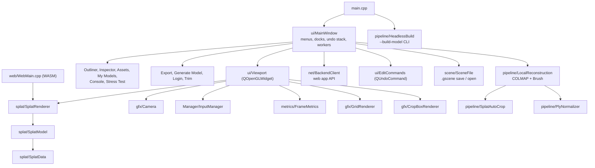

# Engine architecture (`engine/`)

The **Codefine Engine** (shipped as *Genesis Alpha Build*) is a C++20 desktop viewer and editor for 3D Gaussian Splat models. It is built on **Qt 6** (windows, docks, dialogs, networking), **OpenGL 3.3** through GLEW (rendering), **Dear ImGui and ImGuizmo** (the in-viewport overlay and gizmo) and **happly** (`.ply` parsing). The renderer also compiles to **WebAssembly/WebGL2** for the web app.

## How a frame works
`Viewport::paintGL()` runs continuously, paced by vsync. It draws the grid, then the splats (`SplatRenderer::Draw`, either point-cloud sprites or depth-sorted Gaussian ellipses), then the crop box, then the ImGui overlay (gizmo, tool buttons, stats, grid labels). Every frame is timed by `FrameMetrics`. A finished gizmo drag or arrow-key nudge goes back to `MainWindow` as **one** undoable `QUndoCommand`.

## How a model gets into the scene
- **Import a `.ply`** (File menu, Assets panel, drag-and-drop, Recent, or command line): `MainWindow::importSplat` queues it, a worker thread runs `LoadSplatPly` (optionally followed by `TrimSplats`), and the result goes to `SplatRenderer::SetSplats`.
- **Download from the web app** (*My Models*): `BackendClient::downloadResult` saves it into a per-account cache, then it is imported the same way.
- **Generate locally** (*Generate Model*): `LocalReconstruction` runs COLMAP and Brush, then auto-crop and normalization, saves the `.ply`, and imports it.
- **Stress test:** `SplatGenerator::GenerateSphereSplats` is saved to a temporary file and loaded back.
- **Open a scene** (File > Open Scene, drag-and-drop or command line): a worker thread runs `LoadScene` ([scene/SceneFile](scene/SceneFile.md)), which reads every model from the scene's `_data` folder; the current scene is then cleared and each model goes to `SplatRenderer::SetSplats` with its saved transform, trim and visibility.

## File index

| Folder | Page | Summary |
|---|---|---|
| — | [main.md](main.md) | Entry point: GL format, headless mode, theme, window. |
| `Manager/` | [InputManager](Manager/InputManager.md) | Qt input turned into actions and callbacks, Q/W/E/R tool mode. |
| | [StressTestRunner](Manager/StressTestRunner.md) | Timed load, select, move, trim, export, delete and undo tests. |
| `gfx/` | [Camera](gfx/Camera.md) | Orbit camera. |
| | [Shader](gfx/Shader.md) | GLSL program wrapper, with GLES translation. |
| | [GridRenderer](gfx/GridRenderer.md) | Ground grid and axes. |
| | [CropBoxRenderer](gfx/CropBoxRenderer.md) | Wireframe crop box. |
| `metrics/` | [FrameMetrics](metrics/FrameMetrics.md) | Frame timing, drops, sessions, recordings. |
| `net/` | [BackendClient](net/BackendClient.md) | Sign-in, job list and model download from the web backend. |
| `pipeline/` | [GenerationSettings](pipeline/GenerationSettings.md) | Shared build limits and file filters. |
| | [GenerationTypes](pipeline/GenerationTypes.md) | `GenerationRequest`, `JobStatus`. |
| | [LocalReconstruction](pipeline/LocalReconstruction.md) | On-PC COLMAP and Brush pipeline. |
| | [HeadlessBuild](pipeline/HeadlessBuild.md) | `--build-model` command line. |
| | [PlyNormalizer](pipeline/PlyNormalizer.md) | Recentre and rescale a splat `.ply`. |
| | [SplatAutoCrop](pipeline/SplatAutoCrop.md) | Keep only the object the cameras surround. |
| `scene/` | [SceneFile](scene/SceneFile.md) | Save and open `.gscene` scenes. |
| `splat/` | [SplatData](splat/SplatData.md) | `SplatVertex` and decoding. |
| | [SplatLoader](splat/SplatLoader.md) | `.ply` to splats (happly). |
| | [SplatModel](splat/SplatModel.md) | One scene model. |
| | [SplatRenderer](splat/SplatRenderer.md) | Combined buffer, point and Gaussian shaders, background depth sort. |
| | [SplatTrimmer](splat/SplatTrimmer.md) | Alpha, crop and density filters. |
| | [CropBox](splat/CropBox.md) | Box selection and transform helpers. |
| | [SplatExporter](splat/SplatExporter.md) | Export to PLY, `.splat`, OBJ, GLB, STL. |
| | [SplatGenerator](splat/SplatGenerator.md) | Fibonacci test sphere. |
| `ui/` | [MainWindow](ui/MainWindow.md) | Editor shell and all scene commands. |
| | [Viewport](ui/Viewport.md) | GL widget, gizmo, nudges, overlay. |
| | [EditCommands](ui/EditCommands.md) | Undoable commands. |
| | [OutlinerPanel](ui/OutlinerPanel.md), [InspectorPanel](ui/InspectorPanel.md), [AssetBrowserPanel](ui/AssetBrowserPanel.md), [RemoteModelsPanel](ui/RemoteModelsPanel.md), [ConsolePanel](ui/ConsolePanel.md), [StressTestPanel](ui/StressTestPanel.md) | Dock panels. |
| | [ExportDialog](ui/ExportDialog.md), [GenerateModelDialog](ui/GenerateModelDialog.md), [LoginDialog](ui/LoginDialog.md), [TrimDialog](ui/TrimDialog.md) | Dialogs. |
| | [ImGuiQtBackend](ui/ImGuiQtBackend.md), [EditorTheme](ui/EditorTheme.md), [AssetPaths](ui/AssetPaths.md) | Support code. |
| `web/` | [WebMain](web/WebMain.md), [package](web/package.md) | WebAssembly build and the `@codefine/splat-renderer` JS API. |
| build | [BuildSystem](build/BuildSystem.md) | CMake, dependencies, run/package/lint/web scripts. |

Third-party code under `engine/Library/` (Qt and emsdk, once downloaded) is not documented here.
