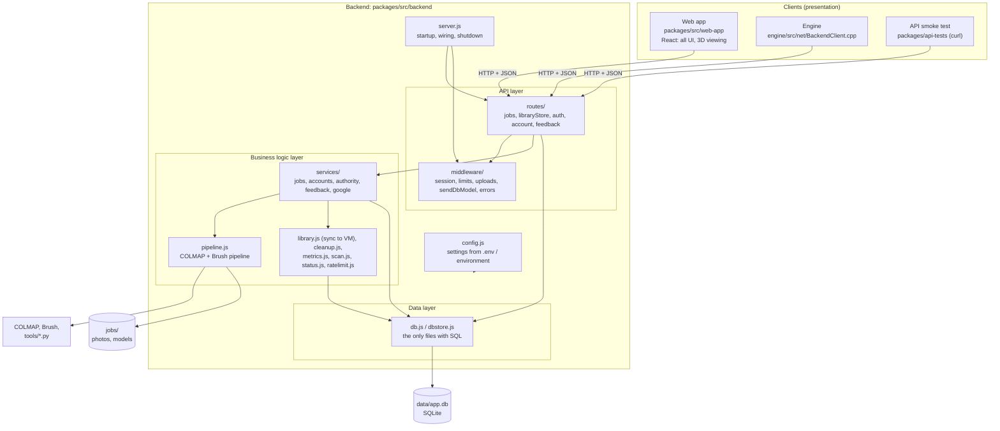
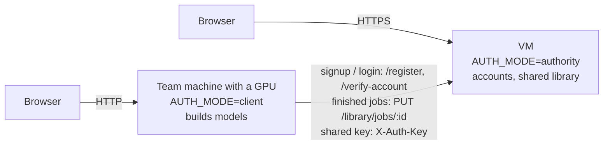

# Genesis web app: architecture

The website turns photos or videos of an object into a 3D Gaussian Splat
model. It is split into a **frontend** (React, in the browser), a **backend**
(Node.js / Express) and **data** (SQLite and job folders), and the backend is
itself split into layers. The frontend never touches the database: it only
calls the backend's HTTP API, which replies with JSON or file data (photos,
`.ply` models), never pages. Any other client can use the same API without
backend changes:
- the engine (`engine/src/net/BackendClient.cpp`, C++/Qt);
- the curl test client (`packages/api-tests/`);
- Postman, or a mobile app.

## Layers

| Layer | Where | Responsibility | Never does |
|---|---|---|---|
| Presentation | `packages/src/web-app/` | Screens, 3D viewing, user input. Calls the API with relative URLs (`/jobs`, `/auth/login`, ...). | Database access, holding secrets. |
| API | `backend/routes/`, `backend/middleware/` | Reads requests, checks sign-in and access, validates input, replies with JSON or file data. | SQL, HTML pages. |
| Business logic | `backend/services/`, `pipeline.js`, `library.js`, `cleanup.js`, `metrics.js`, `scan.js`, `status.js`, `ratelimit.js` | Account rules, job life cycle, the COLMAP / Brush pipeline, sync to the VM, clean-up. `services/` never sees `req` / `res`. | HTTP replies, SQL. |
| Data | `backend/db.js`, `backend/dbstore.js` | Every SQL statement: users, sessions, job ownership, stored photos and models, feedback. | HTTP, UI. |
| Configuration | `backend/config.js`, `backend/.env` (from `.env.example`) | Every server address, port, key and feature flag, read from environment variables. | Hard-coded secrets or server addresses. |

## Machines

- **VM (`AUTH_MODE=authority`):**
  - holds every account and the shared library of finished models (with `FILE_STORE=db`, inside SQLite);
  - serves `/register`, `/verify-account` and `/library/...` to the team machines, which must send the shared `AUTH_API_KEY`;
  - Google sign-in runs here.
- **Team machines (`AUTH_MODE=client`):**
  - build models on their GPU;
  - pass sign-ups and logins to the VM (`VM_AUTH_URL`) and send each finished job there.
- **`AUTH_MODE=local` (default):**
  - one machine on its own, with its own accounts.

## Endpoints

All replies are JSON unless the table says otherwise. "User" means signed in
(the `genesis_session` cookie). "Owner" means the job's owner or an admin;
someone else's job answers 404. Every `/library/...` route is VM-only and
needs the shared key.

### Accounts

| Method | Path | Who | Reply |
|---|---|---|---|
| POST | `/auth/signup` | anyone | 201 user + session cookie; 400 / 409 / 429 |
| POST | `/auth/login` | anyone | 200 user + session cookie; 401 / 429 |
| GET | `/auth/me` | user | 200 user; 401 |
| POST | `/auth/logout` | anyone | 204 |
| GET | `/auth/me/account` | user | 200 account details |
| PATCH | `/auth/me` | user | 200 account details (new name) |
| POST | `/auth/me/password` | user | 200 account details; other sessions signed out |
| GET / PUT / DELETE | `/auth/me/avatar` | user | GET: the image (JPEG / PNG); PUT / DELETE: account details |
| GET | `/auth/me/storage` | user | 200 `{ usedBytes, models, jobs }` |
| GET | `/auth/google` | anyone | 302 to Google (VM), or to the VM's `/auth/google` |
| GET | `/auth/google/callback` | Google's redirect | 302 to `/` (signed in) or `/?login=...` |
| POST | `/register`, `/verify-account` | team machines (shared key) | create an account / check a password |

### Jobs (models and their photos)

| Method | Path | Who | Reply |
|---|---|---|---|
| POST | `/upload` | user | 202 `{ id, imageCount }`. Multipart `images` (8+ JPEG / PNG), optional `trainIters`, `removeBackground` |
| POST | `/jobs/from-media` | user | 202 `{ id }`. Multipart `media` (videos / GIFs), optional `fps`, `maxFrames`, `trainIters`, `removeBackground` |
| GET | `/jobs` | user | 200 list of the user's jobs (admins: all) |
| GET | `/jobs/:id` | owner | 200 status, phase, progress, log tail |
| PATCH | `/jobs/:id` | owner | 200 `{ id, name, sampleFile }` (rename) |
| DELETE | `/jobs/:id` | owner | 200 cancelled; 409 if already finished |
| DELETE | `/jobs/:id/files` | owner | 200 `{ id, deleted: true }` |
| GET | `/jobs/:id/images/:name` | owner | the photo (binary) |
| GET / HEAD | `/jobs/:id/result.ply` | owner | the model (binary, byte ranges supported) |
| GET | `/jobs/:id/cover.webp` | owner | the card cover (binary); 404 if none |
| PUT | `/library/jobs/:id` | team machines (shared key) | 201 `{ id, bytes }`. Stores a finished job on the VM |

### Feedback

| Method | Path | Who | Reply |
|---|---|---|---|
| POST | `/feedback` | user | 201 `{ id }`. Body `{ category: 'bug' \| 'idea' \| 'other', message }` |
| GET | `/feedback` | admin | 200 `{ items, hasMore }`. Query `category`, `before` |

Any other path answers 404 with a JSON `{ error }`.

## Configuration and secrets

- Every setting comes from environment variables, usually set in
  `packages/src/backend/.env`. Copy
  [`.env.example`](../packages/src/backend/.env.example), which lists every
  variable with its default.
  - `.env` (and a dot-less `env`) is gitignored.
  - The shared key, the VM's address and the Google client secret are never
    written in the code or committed.
- The web app has no server addresses in it: it uses relative URLs. In
  development, Vite forwards them to the backend's port (`vite.config.js`).
- The engine's sign-in dialog asks for the server address. It defaults to
  this machine's backend and is saved in the engine's settings.

## Testing the API on its own

`packages/api-tests/api-smoke.sh` (or `api-smoke.bat` on Windows) signs in
and calls the endpoints above with curl, checking each status code. See
[its README](../packages/api-tests/README.md).
