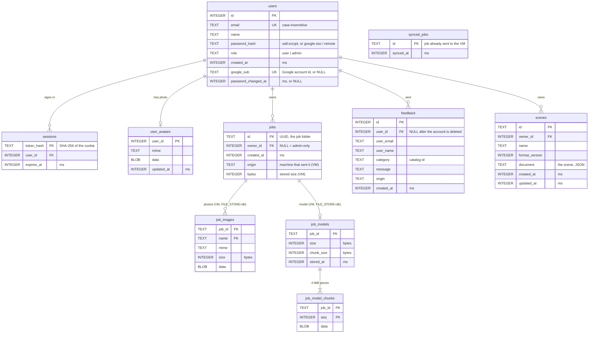

# Genesis data schema

One schema is shared by the database, the backend and its clients (the web
app, the engine, the curl tests). This page covers:

- the rules every part follows;
- the database tables;
- how each entity is named in each place;
- every saved file format and its version.

The exact formats are JSON Schema files in
[`packages/src/backend/schemas/`](../packages/src/backend/schemas). The
backend checks data against these same files (`schemas.js`), so this page and
the code can't drift apart.

## Rules

| What | Standard | Where it's enforced |
|---|---|---|
| Names | Database columns are `snake_case`. JSON (API, files) is `camelCase`. The conversion happens only in `db.js`, the only file with SQL. | `db.js` |
| Dates and times | **UTC epoch milliseconds, as a number**, everywhere: database columns, API v1, saved files. Example: `1791101700000` is 2026-10-04 08:15:00 UTC. | Migration 003; `adapters/apiVersions.js` |
| Ids | Job: UUID v4 text (the folder name under `jobs/`). User: integer. Scene: UUID v4 text (scenes moved from a browser keep their `scene-…` id). Sample job: `sample-…`. | `scan.js` `JOB_ID_RE`, schemas |
| Sizes | In the API and database: **bytes** (`size`, `bytes`, `usedBytes`). Settings carry their unit in the name: `maxFileSizeMB`, `maxAvatarKB`, `STORAGE_BUDGET_GB`. | `config.js` |
| 3D coordinates | Scenes use the world units of the normalized models (`tools/normalize_ply.py` recenters each model). **Y is up.** `position` is `[x, y, z]`; `rotation` is XYZ Euler angles **in degrees**; `scale` is a factor per axis. | `scene.v1.schema.json` |
| Fixed choices | Job `status`: `queued`, `running`, `done`, `error`, `cancelled`. User `role`: `user`, `admin`. Feedback `category`: an id from `catalog/catalog.json`. | Schemas, the database `CHECK`s, `catalog.js` |
| Reference data | Feedback categories, training presets and the photo minimum live in `catalog/catalog.json` (`catalog.schema.json`), served by `GET /api/v1/catalog`. They are not in the code. | `catalog.js` |

The legacy (unversioned) API paths keep sending users', account and feedback
dates as ISO text, as they always have. See [api-changelog.md](api-changelog.md).

## Database

SQLite file `packages/src/backend/data/app.db`, built and changed only by the
numbered migrations in `packages/src/backend/migrations/`. Its version is
`PRAGMA user_version`; the current version is 4.

A job's photos, model, status and metrics live in its folders,
`jobs/<id>/` and `jobs/<id>_out/`. On the VM with `FILE_STORE=db`, the photos
and model live in the tables above instead.

## The same entity everywhere

| Entity | Database | API v1 (JSON) | Frontend / engine |
|---|---|---|---|
| **User** | `users` (`id`, `email`, `name`, `role`, `created_at`) | `GET /api/v1/auth/me` → `{ name, email, role, createdAt, memberSince }` | `App.jsx` session (`user.name`, `user.role`); engine `RemoteUser` (`name`, `email`, `role`) |
| **Account details** | `users` + `user_avatars` | `GET /api/v1/auth/me/account` → User + `emailVerified`, `passwordChangedAt`, `signInMethods { password, google }`, `photoVersion` | `AccountScreen.jsx` |
| **Job** (a photo batch and its model) | `jobs` (owner), `jobs/<id>/status.json`, `job_images`, `job_models` | **JobSummary** in `GET /api/v1/jobs` (`job-summary.schema.json`): `id`, `name`, `status`, `phase`, `progress`, `detail`, `error`, `createdAt`, `updatedAt`, `imageCount`, `hasResult`, `thumbnail`, `cover`, `images[{name, url}]` | Library, Home, Image Gallery, Model Viewer (`job.id`, `job.name`, `job.createdAt`); engine `RemoteJob` (`id`, `name`, `status`, `progress`, `createdAt`, `updatedAt`, `imageCount`, `hasResult`) |
| **Job status** | `jobs/<id>/status.json` (`job-status.schema.json`) | `GET /api/v1/jobs/:id` → `{ id, status, phase, progress, detail, error, updatedAt, imageCount, removeBackground, hasResult, logTail }` | `Processing.jsx`, `FrameExtractor.jsx` |
| **Feedback** | `feedback` (`user_name`, `user_email`, `category`, `message`, `origin`, `created_at`) | `GET /api/v1/feedback` → `{ items: [{ id, name, email, category, message, origin, createdAt }], hasMore }` | `FeedbackInbox.jsx`, `FeedbackScreen.jsx` |
| **Scene** | `scenes` (`document` holds the whole scene) | `GET /api/v1/scenes/:id` → the scene document (`scene.v1.schema.json`) | `SceneStorage.js`, `SceneBuilderScreen.jsx` (same field names) |
| **Reference data** | `catalog/catalog.json` | `GET /api/v1/catalog` | still copied in `FeedbackCategories.js` and `TrainingPresets.js` until the website reads the catalog |

## Saved formats and versions

Every saved format records its version. A reader converts older versions
when it loads them, and refuses a version newer than it knows instead of
guessing. Adding an optional field doesn't change the version; removing,
renaming or changing a field does, and the new version ships with a
converter from the old one.

| What | Where | Version field | Schema | Older versions |
|---|---|---|---|---|
| Database | `data/app.db` | `PRAGMA user_version` (4) | the migrations | Every older database is brought up to date at startup, after a backup (`migrate.js`). Also by hand: `npm run migrate -- --db <file>`. |
| Job status | `jobs/<id>/status.json` | `version` (1) | `job-status.schema.json` | `status.js` runs each record through `STATUS_UPGRADES`. Every record written so far is version 1. A newer record is skipped with a warning. |
| Scene | `scenes.document` | `format: "genesis.scene"`, `version` (1) | `scene.v1.schema.json` | Version 0 (the browser-only format, no `format` / `version`) is converted on save (`services/scenes.js`). A newer version is refused with 422. Loading returns exactly what was saved. |
| Run metrics | `jobs/<id>_out/metrics.json`, `jobs/metrics.jsonl` | `version` (1) | in `metrics.js` | Version 1 still writes `createdAt` / `finishedAt` as ISO text, the one exception to the date rule. The metrics dashboard reads them as text. Moving to ms means a version 2, with the dashboard reading both. |
| Reference data | `catalog/catalog.json` | `version` (1) | `catalog.schema.json` | Checked at startup; a broken file stops the backend with the reason. |
| Sample jobs | `sample-data/jobs.json` | `version` (1) | `sample-jobs.schema.json` | Checked at startup when `JOB_SOURCES` includes `sample`. |
| Settings | `packages/src/backend/.env` | none (key = value) | [`.env.example`](../packages/src/backend/.env.example) lists every key | Unknown keys are ignored; bad values for `AUTH_MODE` or `JOB_SOURCES` stop startup. |
